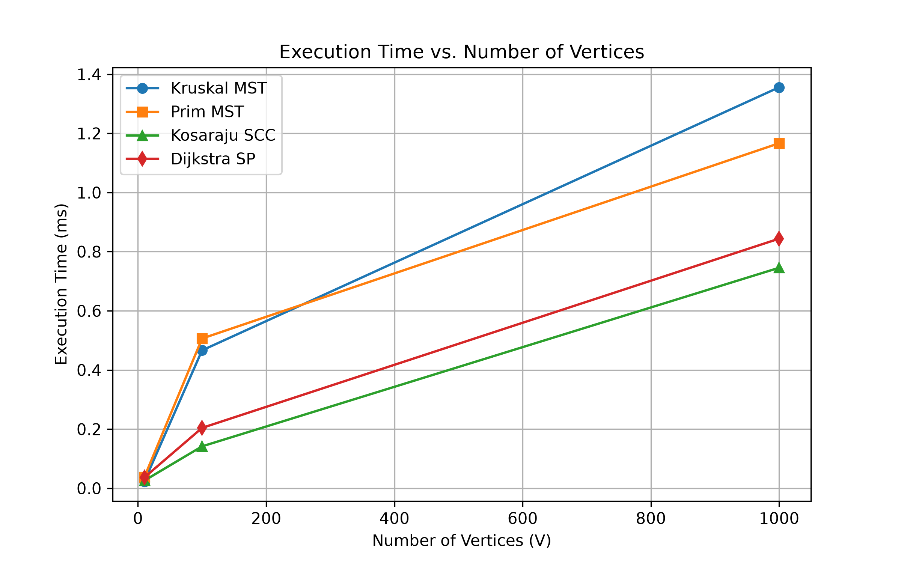

# Assignment 3 — Smart City Infrastructure and Route Planning

## 1. Overview
This project models a smart city's infrastructure network and route planning system in Java. A city is represented as a weighted graph $G = (V, E)$, where:
* **Vertices ($V$):** City districts, hubs, or service locations.
* **Edges ($E$):** Two-way roads (undirected edges) or one-way routes and service dependencies (directed edges).
* **Weights ($w$):** Road construction costs (for Minimum Spanning Tree design) or travel distances/times (for shortest-path routing).

The application provides an end-to-end toolkit for urban planners to:
1. Design a minimum-cost backbone network connecting all city districts (**Kruskal's** and **Prim's** algorithms).
2. Analyze one-way traffic flow, detect circular dependencies, schedule infrastructure tasks (**Topological Sort**), and identify mutually reachable district clusters (**Strongly Connected Components** via **Kosaraju's** algorithm).
3. Compute optimal emergency and transit routes from a central district to all other reachable locations (**Dijkstra's** algorithm).

---

## 2. Implementation
The codebase follows a clean, modular architecture organized by algorithmic domain:

```text
assignment-3/
├── src/
│   ├── graph/
│   │   ├── RoadEdge.java            # Weighted edge model implementing Comparable<RoadEdge>
│   │   ├── CityGraph.java           # Adjacency list graph (supports directed & undirected)
│   │   └── CityGraphGenerator.java  # Reproducible graph generator (fixed seed = 42)
│   ├── dsu/
│   │   └── DisjointSetUnion.java    # Union-Find with path compression & union by rank
│   ├── mst/
│   │   ├── KruskalPlanner.java      # Kruskal's MST algorithm + operation counters
│   │   └── PrimPlanner.java         # Prim's MST algorithm using PriorityQueue
│   ├── connectivity/
│   │   ├── TopologicalSorter.java   # 3-color DFS topological sort & cycle detector
│   │   └── KosarajuSCC.java         # Two-pass DFS Kosaraju's SCC algorithm
│   ├── shortestpath/
│   │   └── DijkstraRouter.java      # PriorityQueue-based Dijkstra + path reconstruction
│   └── MainApp.java                 # 7 correctness test scenarios & 5-run benchmark suite
├── results/
│   ├── tables/
│   │   └── benchmark_results.csv    # Recorded experimental metrics
│   └── plots/
│       ├── time_vs_vertices.png     # Execution time vs. V plot
│       └── time_vs_edges.png        # Execution time vs. E plot
└── README.md
```

### Main Design Decisions
* **Adjacency List Representation (`CityGraph`):** Urban road networks are naturally sparse ($E \ll V^2$). Using adjacency lists (`List<List<RoadEdge>>`) ensures $\Theta(V + E)$ memory consumption and fast neighbor iteration compared to an $\Theta(V^2)$ adjacency matrix.
* **Standard Library Priority Queues:** In accordance with software engineering best practices from our course lectures (*"Use `PriorityQueue` instead of a hand-rolled heap unless you need custom behavior"*), both `PrimPlanner` and `DijkstraRouter` utilize `java.util.PriorityQueue` (binary min-heap).
* **Instrumentation Counters:** Every algorithm class encapsulates non-intrusive counters (`comparisons`, `edgesExamined`, `dsuOperations`, `relaxationsCount`) to link empirical runtime with theoretical operation counts.

---

## 3. Complexity Analysis

All analyses below assume the graph is represented using **adjacency lists** and that priority queues are implemented as **binary min-heaps** (`PriorityQueue`).

| Algorithm / Structure | Time Complexity | Space Complexity | How $V$ and $E$ Affect Performance & Assumptions |
| :--- | :--- | :--- | :--- |
| **DSU (`find`, `union`)** | $O(\alpha(V))$ amortized per op<br>($O(m \cdot \alpha(V))$ for $m$ ops) | $O(V)$ | Maintains `parent[]` and `rank[]` arrays of size $V$. Combining **path compression** and **union by rank** bounds tree height and yields near-constant time, where $\alpha(V) \le 4$ is the inverse Ackermann function. |
| **Kruskal's Algorithm** | $O(E \log E)$ or $O(E \log V)$ | $O(V + E)$ | Sorting all $E$ edges takes $O(E \log E)$ comparisons. Processing $E$ edges through DSU takes $O(E \cdot \alpha(V))$. Since $E \le V^2$, $\log E = O(\log V)$, edge sorting dominates runtime as $E$ grows. |
| **Prim's Algorithm** | $O(E \log V)$ | $O(V + E)$ | Using a lazy binary heap (`PriorityQueue`), each of the $E$ edges is inserted and polled at most once, costing $O(\log E) = O(\log V)$ per heap operation. Auxiliary arrays (`inTree[]`) and heap storage take $O(V + E)$ space. |
| **Topological Ordering** | $\Theta(V + E)$ | $O(V + E)$ | Performs a single Depth-First Search (DFS) with 3-state vertex coloring (`UNVISITED`, `VISITING`, `VISITED`). Visits each vertex once ($O(V)$) and examines each directed edge once ($O(E)$). Call stack and state arrays use $O(V)$ extra space. |
| **Kosaraju's SCC** | $\Theta(V + E)$ | $O(V + E)$ | Executes Pass 1 DFS on $G$ in $\Theta(V + E)$, constructs the transposed graph $G^T$ by reversing all edges in $\Theta(V + E)$ time and space, and runs Pass 2 DFS on $G^T$ in $\Theta(V + E)$ in reverse postorder. |
| **Dijkstra's Algorithm** | $O((V + E) \log V)$ | $O(V + E)$ | Each vertex is extracted from the priority queue, and each outgoing edge is examined once ($O(E)$). Successful edge relaxations push updated distances into the binary heap in $O(\log V)$ time. Stores `distTo[]` and `parentOf[]` arrays of size $V$. |

---

## 4. Experimental Setup

### Graph Configurations
We evaluated the algorithms across three network scales with edge density $E \approx 3V$ to $5V$:
* **Small:** $V = 10$, $E = 30$
* **Medium:** $V = 100$, $E = 500$
* **Large:** $V = 1,000$, $E = 5,000$

### Graph Generation & Reproducibility
All graphs are generated deterministically in `CityGraphGenerator` using a fixed random seed (`seed = 42L`) with edge weights uniformly distributed in $[1, 100]$:
1. **Connected Undirected Graphs (MST):** First builds a random spanning tree of $V - 1$ edges by linking each vertex $i \in [1, V-1]$ to a random vertex in $[0, i-1]$. Then adds random unique undirected edges until $|E|$ edges are reached.
2. **Directed Acyclic Graphs (DAG):** Generates unique directed edges $(u, v)$ strictly enforcing $u < v$. Because all edges point from a lower vertex index to a higher vertex index, topological acyclicity is mathematically guaranteed.
3. **Directed Cyclic Graphs (SCC & Dijkstra):** Embeds a guaranteed directed cycle ($0 \to 1 \to 2 \to 0$) and populates the remaining unique directed edges $(u, v)$ randomly across all vertices, producing realistic multi-component cyclic networks.

### Measurement Procedure
* **JVM Warmup:** Before recording timings, the benchmark runner executes warmup passes on a medium-sized graph so the HotSpot JIT compiler optimizes critical code paths.
* **Averaging:** Each algorithm is executed **5 times** per graph size. Execution time is measured exclusively around the algorithm invocation using `System.nanoTime()` and converted to milliseconds (`ms`).

---

## 5. Results

The full dataset is saved in [`results/tables/benchmark_results.csv`](results/tables/benchmark_results.csv).

### Table 1: Kruskal vs. Prim Comparison (Connected Undirected Graphs)
| Size | Vertices ($V$) | Edges ($E$) | Kruskal Time (ms) | Kruskal Comparisons | DSU Operations | Prim Time (ms) | Prim Comparisons | MST Weight Match |
| :--- | :---: | :---: | :---: | :---: | :---: | :---: | :---: | :---: |
| **Small** | 10 | 30 | 0.0234 | 107 | 127 | 0.0379 | 144 | `true` |
| **Medium** | 100 | 500 | 0.4664 | 3,827 | 1,675 | 0.5064 | 3,742 | `true` |
| **Large** | 1,000 | 5,000 | 1.3558 | 50,369 | 36,442 | 1.1666 | 85,148 | `true` |

### Table 2: Topological Sort, Kosaraju SCC, and Dijkstra (Directed Graphs)
| Size | Vertices ($V$) | Edges ($E$) | Topo Sort DAG (ms) | Topo Sort Cyclic (ms) | Kosaraju SCC Time (ms) | SCC Count | Dijkstra Time (ms) | Edge Relaxations |
| :--- | :---: | :---: | :---: | :---: | :---: | :---: | :---: | :---: |
| **Small** | 10 | 30 | 0.0173 | 0.0021 | 0.0260 | 1 | 0.0367 | 11 |
| **Medium** | 100 | 500 | 0.0428 | 0.0028 | 0.1418 | 2 | 0.2042 | 149 |
| **Large** | 1,000 | 5,000 | 0.2531 | 0.0030 | 0.7456 | 18 | 0.8440 | 1,418 |

### Performance Plots

#### Execution Time vs. Number of Vertices ($V$)


#### Execution Time vs. Number of Edges ($E$)


---

## 6. Comparison and Discussion

### 1. Kruskal vs. Prim: Execution Time and Operation Counts
* **Small & Medium Graphs:** Kruskal's algorithm is slightly faster (`0.0234 ms` vs. `0.0379 ms` on Small; `0.4664 ms` vs. `0.5064 ms` on Medium). Sorting a contiguous `ArrayList` of 30 to 500 edges via Java's TimSort benefits from CPU cache locality, and DSU array lookups have minimal overhead.
* **Large Graphs ($V = 1,000, E = 5,000$):** Prim's algorithm overtakes Kruskal's (`1.1666 ms` vs. `1.3558 ms`), even though Prim performs more heap comparisons (`85,148` vs. `50,369`). Kruskal must sort all $5,000$ edges upfront before examining them, whereas Prim only pushes edges incident to visited vertices into the priority queue and terminates immediately once $V - 1 = 999$ tree edges are found. Both algorithms produce identical total MST weights across all configurations.

### 2. How Path Compression and Union by Rank Improve DSU Performance
* Without optimizations, repeated `union` operations can degenerate a DSU forest into a linear chain of height $O(V)$, making each `find(x)` take $O(V)$ time.
* **Union by Rank** attaches the root of the shorter tree (smaller rank) under the root of the taller tree, guaranteeing that any tree of rank $r$ has at least $2^r$ nodes and bounding maximum tree height by $\lfloor \log_2 V \rfloor$.
* **Path Compression** flattens trees during `find(x)` by setting `parent[x] = find(parent[x])` for every visited node along the path to the root. Subsequent queries on those nodes execute in $O(1)$ direct lookups.
* In Table 1, for $V = 1,000$ and $E = 5,000$, the total number of DSU operations (`find` calls + `union` calls + `parent` array accesses) is only `36,442`—an average of roughly $3.6$ array accesses per edge check, confirming the theoretical $O(\alpha(V))$ amortized bound.

### 3. SCC and Topological Ordering Runtime Behavior
* **Topological Ordering (DAG vs. Cyclic):** On DAGs, `TopologicalSorter` traverses every vertex and edge, scaling linearly from `0.0173 ms` ($E=30$) to `0.2531 ms` ($E=5,000$). On cyclic graphs, execution finishes almost instantaneously (`0.0021 ms` to `0.0030 ms`) because our DFS detector aborts traversal as soon as it encounters the first back-edge (`state[v] == VISITING`).
* **Kosaraju's SCC Scaling:** Runtime grows linearly with $V + E$ (`0.0260 ms` $\to$ `0.1418 ms` $\to$ `0.7456 ms`). It takes roughly $3\times$ the time of a single DAG topological sort because it performs two complete DFS passes plus an $O(V + E)$ graph transposition step.

### 4. Dijkstra's Algorithm Performance & Why It Fails on Negative Edge Weights
* **Scaling & Relaxations:** Dijkstra's runtime scales smoothly (`0.0367 ms` $\to$ `0.2042 ms` $\to$ `0.8440 ms`). On the Large graph ($E = 5,000$), only `1,418` edges trigger distance improvements (`relaxations`), keeping the binary heap compact and fast.
* **Why Dijkstra is Unsuitable for Negative Edge Weights:** Dijkstra's correctness relies on the greedy invariant that when a vertex $u$ is extracted from the priority queue with the minimum tentative distance `distTo[u]`, no future path through any unvisited vertex $w$ can ever yield a shorter path to $u$. This holds **only** if all edge weights are non-negative ($w(e) \ge 0$), because adding more edges to a path can only increase or maintain its total weight. If a graph contains an edge $(w, u)$ with a negative weight $w(w, u) < 0$, a path discovered later could satisfy $\text{distTo}[w] + w(w, u) < \text{distTo}[u]$ after $u$ has already been finalized and popped from the queue, causing Dijkstra to return sub-optimal distances (or enter infinite loops on negative cycles). For graphs with negative weights, the Bellman-Ford algorithm ($O(V \cdot E)$) must be used instead.

---

## 7. Testing

All 7 required edge-case scenarios are implemented and verified automatically in `MainApp.runAllCorrectnessTests()`:

1. **Small Graph ($V = 4, E = 5$):** Verifies that Kruskal and Prim both compute the exact minimum spanning tree weight (`19.0`).
2. **Disconnected Graph:** Tests a 4-vertex graph split into two isolated components ($\{0, 1\}$ and $\{2, 3\}$). Both `KruskalPlanner.isConnected()` and `PrimPlanner.isConnected()` accurately return `false`.
3. **Graph Containing Cycles:** Tests a directed graph with cycle $0 \to 1 \to 2 \to 0$ and tail $2 \to 3$. `TopologicalSorter.hasCycle()` returns `true` (and returns `null` for the topological order), while `KosarajuSCC` partitions the vertices into `2` exact components: `[[0, 2, 1], [3]]`.
4. **Graph with Multiple Valid MSTs & Duplicate Edge Weights (Scenarios 4 & 6):** Tests a 4-vertex square with diagonal where all 5 edges have identical weight `5.0`. Both Kruskal and Prim handle duplicate weights without error and return matching total MST weight (`15.0`).
5. **Graph with Unreachable Vertices:** Tests `DijkstraRouter` on a 5-vertex directed graph where vertices `3` and `4` have no incoming path from source `0`. Verifies optimal shortest path `0 -> 2` is `[0, 1, 2]` with distance `7.0` (bypassing direct edge of cost `10.0`), while `isReachable(4)` is `false` and `getShortestDistance(4)` is `Infinity`.
6. **Single-Vertex Graph ($V = 1, E = 0$):** Verifies boundary conditions: MST is connected with weight `0.0`, topological ordering is `[0]`, SCC returns `[[0]]`, and Dijkstra distance to source `0` is `0.0`.

---

## 8. Conclusion
This project demonstrates how theoretical graph algorithms translate into practical tools for smart city infrastructure planning:
* **Infrastructure Backbone Design (MST):** Both **Kruskal's** (with DSU) and **Prim's** (with `PriorityQueue`) reliably find minimum-cost spanning networks in $O(E \log V)$ time. Kruskal is simple and fast on smaller or edge-centric datasets, while Prim is slightly faster on larger connected graphs due to early termination and localized heap operations.
* **Dependency & Connectivity Analysis:** **DFS Topological Sorting** and **Kosaraju's SCC** run in optimal linear $\Theta(V + E)$ time, making them ideal for detecting circular dependencies and identifying isolated or strongly connected zones in one-way road networks.
* **Route Planning:** **Dijkstra's Algorithm** provides fast $O((V + E) \log V)$ single-source shortest-path routing across city districts, provided all road weights (distances or travel times) are non-negative.
